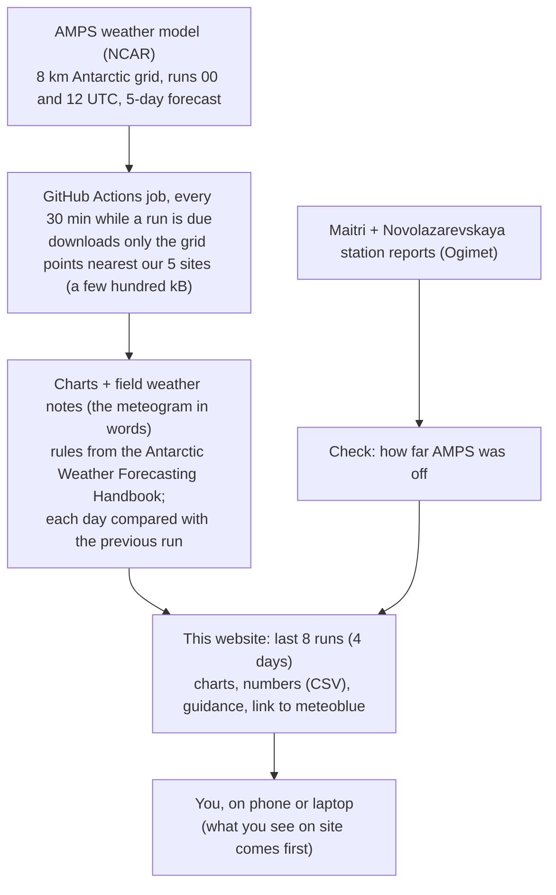

# MINIS Meteograms

Five-day weather guidance for the MINIS fieldwork on Nivlisen and at Maitri (Dronning Maud Land,
Antarctica), from the Antarctic Mesoscale Prediction System (AMPS, NCAR; WRF 8 km).

**Site:** https://vikramonice.github.io/minis-weather/

For each of five sites along the route (Maitri, A12 at the Potsdam shear margin, C13 in the
grounding zone, Depot 43D, MN_04) the page shows a meteogram (temperature, wind chill, cloud, snow, wind, pressure),
rule-based guidance text, and a running check of AMPS against the Maitri and Novolazarevskaya
station reports. Charts (PNG) and numbers (CSV) can be downloaded.

Model guidance only, not a forecast: gusts are stronger than the mean wind, and conditions on the
spot come first.

## How it works

## How it updates

A GitHub Actions workflow (`.github/workflows/update.yml`) checks every 30 minutes while a
new AMPS run is due (09:00-12:00 and 21:00-00:30 UTC; runs finish about 10 h after 00/12 UTC). `publish.py` reads the previous state from the `gh-pages` branch, fetches only the few
hundred kB of AMPS GRIB it needs (HTTP byte ranges), makes the charts, guidance and station
check, rebuilds the page (the last 8 runs = 4 days) and force-pushes `gh-pages` as a single
commit. Run it by hand from the Actions tab ("Run workflow"); tick *rebuild* after changing the
page template.

Scripts in `amps/` are copied from the Nivl project (`code/python/fieldwork/amps_*`); change
them there and copy them here.

Data: AMPS, NCAR, run for NSF. Station reports via ogimet.com.
